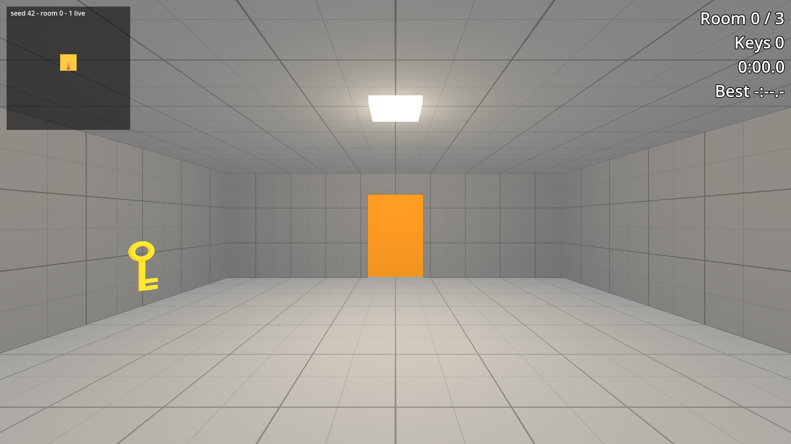

# Keys and Locked Doors in Godot 4

Project files for tutorial 04 of the Godot 4 series by Phaix on YouTube (https://www.youtube.com/@Phaix).

Lock doors in a generated level in Godot 4 and make sure every run can still be finished: a key pickup, a locked door that asks the level, key spots on markers with a second seeded generator, a headless check over a thousand seeds, and feedback when a door stays shut. Every step is its own project folder.



## Steps

Every step of the video is its own folder in `steps/`, the exact state at the end of that
part. Open the project in Godot 4.7, then open `steps/<step>/main.tscn` and press F6 to run
that step. The project's main scene is the final step.

| Folder | Part of the video |
|---|---|
| `steps/step_00_start` | Starting point (the final state of the previous tutorial) |
| `steps/step_01_key_pickup` | Step 1 - A key to pick up |
| `steps/step_02_locked_door` | Step 2 - A locked door |
| `steps/step_03_key_spots` | Step 3 - Spots for keys |
| `steps/step_04_always_solvable` | Step 4 - Always solvable |
| `steps/step_05_locked_feedback` | Step 5 - Feedback |

## Controls

WASD or arrow keys or the left stick to walk, mouse or right stick to look, Space to jump,
Esc gives the mouse back, a click captures it again. Further keys per tutorial are shown
in the video and in the HUD.

## Tests

```sh
godot --headless --path . -s res://tests/run_tests.gd
```

## License

Code and scenes: MIT (see LICENSE).
